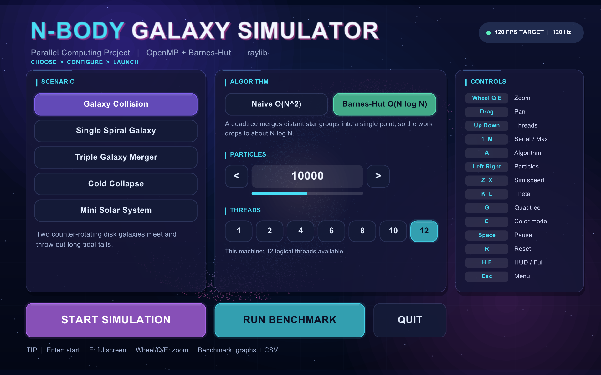
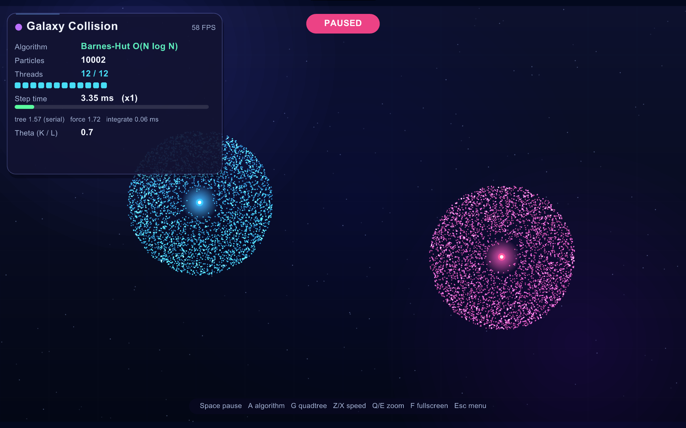
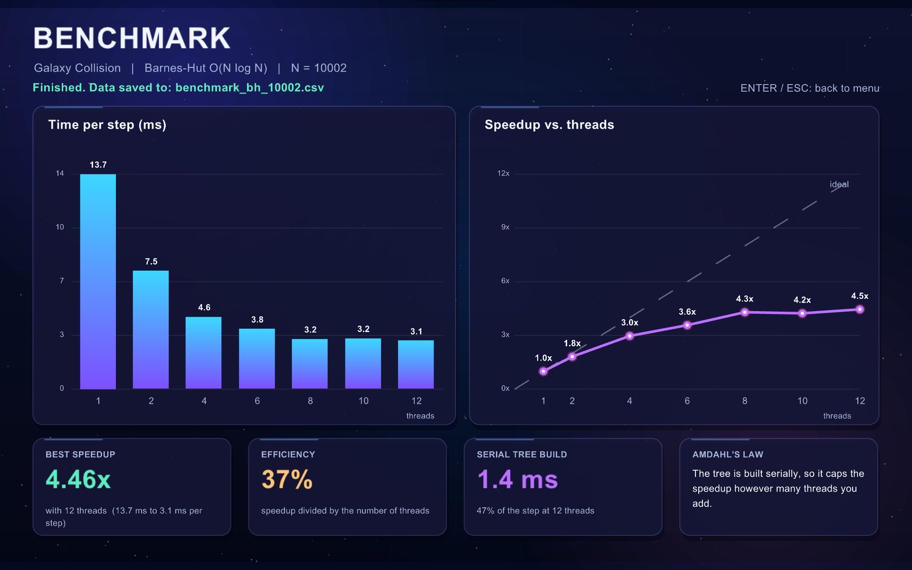
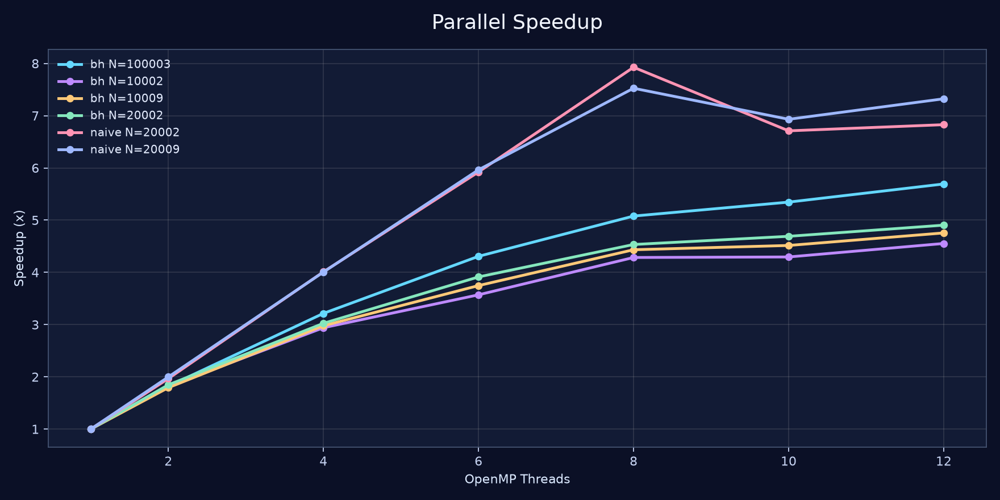
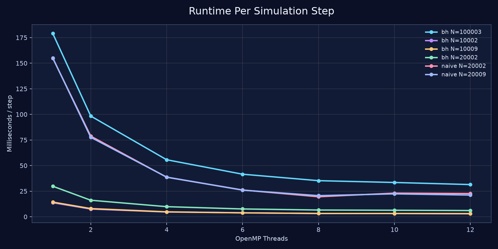

<div align="center">

# 🌌 N-BODY GALAXY SIMULATOR

### Parallel Computing · Barnes-Hut · OpenMP · C++17


**An interactive N-body galaxy simulator for exploring parallel algorithms, gravitational interactions, and CPU performance.**



</div>

---

## Overview

This project implements gravitational N-body simulations
in both **2D** and **3D** using C++17, OpenMP, and raylib.

Its primary purpose is to investigate how algorithm
selection and CPU parallelization influence the
performance of computationally intensive simulations.

The project compares:

- Direct all-pairs gravitational force calculation.
- Barnes-Hut hierarchical force approximation (quadtree in 2D, octree in 3D).
- Single-threaded and multi-threaded execution.

The simulator includes interactive visualizations,
performance measurements, and benchmark exports.

> This is an educational computational model using
> normalized units, not a validated astrophysical
> prediction system. CPU threads calculate physics;
> raylib provides graphics.

## Simulators

| Binary | Source | Dimensions | Tree |
|---|---|---|---|
| `./nbody` | `src/nbody.cpp` | 2D | Quadtree |
| `./nbody3d` | `src/nbody3d.cpp` | 3D | Octree |

The 3D version extends every scenario into full three-dimensional space,
adds perspective camera controls, orbital rotation, and replaces the
Barnes-Hut quadtree with an octree for 8-children spatial decomposition.

## Features

- Five interactive simulation scenarios (2D and 3D).
- Naive O(N²) gravitational force calculation.
- Barnes-Hut quadtree/octree approximation.
- OpenMP-based parallel force evaluation.
- Adjustable CPU thread count.
- Variable particle counts.
- Interactive camera controls.
- Color visualization modes.
- Quadtree visualization.
- Live simulation statistics.
- Runtime and speedup benchmarking.
- CSV result export.
- Dark-space-themed interface.

## Simulation Scenarios

| Scenario | Description |
|---|---|
| Galaxy Collision | Two interacting disk galaxies |
| Single Spiral Galaxy | Rotating spiral structure |
| Triple Galaxy Merger | Three interacting galaxies |
| Cold Collapse | Gravitational collapse of a particle cloud |
| Mini Solar System | Central mass, planets, and an asteroid belt |

## Algorithms

### 1. Naive Direct Summation

In the direct approach, the force acting on each
particle is calculated by considering all other
particles.

For N particles, computational complexity grows
quadratically:

**O(N²)**

This approach provides a straightforward baseline
and is suitable for studying data parallelism.

The outer per-particle force loop is parallelized
using OpenMP with static scheduling.

### 2. Barnes-Hut Algorithm

Barnes-Hut reduces computational work by organizing
particles into a hierarchical spatial tree.

The 2D implementation uses a **quadtree**; the 3D
implementation uses an **octree** with 8 children.

Distant particle groups can be approximated using
their combined mass and center of mass.

The opening angle parameter, theta, controls the
accuracy-performance trade-off.

Typical computational complexity is:

**O(N log N)**

This is an expected scaling behavior under favorable
conditions, not a guarantee for every distribution.

The tree is built serially, while force queries are
parallelized using OpenMP dynamic scheduling.

### 3. Numerical Integration

Particle velocity and position are updated using
a fixed timestep and semi-implicit Euler-style
integration.

The force model includes gravitational softening
to reduce numerical singularities.

The simulation uses deterministic initial seeds.
Numerical and approximation errors should be
considered when interpreting the results.

## Parallel Computing

OpenMP distributes independent particle-force
calculations among CPU threads.

The experiment demonstrates:

- Data parallelism.
- Work distribution.
- Static versus dynamic scheduling.
- Parallel speedup.
- Parallel efficiency.
- Serial bottlenecks and Amdahl's law.

## Installation — macOS

### Requirements

- macOS
- Xcode Command Line Tools
- Homebrew
- C++17 compiler
- OpenMP / libomp
- raylib

Apple Silicon is the primary development target.

### Install Dependencies

```bash
xcode-select --install
brew install libomp raylib gh
```

Skip the first command if Command Line Tools
are already installed.

### Clone and Build

```bash
git clone https://github.com/ErenA001/Parallel_Computing_Project_NBody_Galaxy_Simulation.git
cd Parallel_Computing_Project_NBody_Galaxy_Simulation
make        # build 2D simulator
make 3d     # build 3D simulator
```

Or use the scripts directly:

```bash
./scripts/build_macos.sh     # 2D
./scripts/build_macos_3d.sh  # 3D
```

#### Makefile targets

| Target | Description |
|---|---|
| `make` | Build 2D simulator (`./nbody`) |
| `make 3d` | Build 3D simulator (`./nbody3d`) |
| `make all` | Build both |
| `make test` | Build and run OpenMP test |
| `make run` | Build and launch 2D |
| `make run3d` | Build and launch 3D |
| `make clean` | Remove compiled binaries |

The physics runs on CPU threads. The graphical
interface uses raylib and OpenGL.

Target render FPS: **120**. Actual FPS depends on hardware and workload.

## Controls

### 2D Simulator (`./nbody`)

| Input | Function |
|---|---|
| Space | Pause / resume |
| A | Naive / Barnes-Hut |
| Up / Down | Change OpenMP threads |
| 1 / M | One / maximum threads |
| Left / Right | Change particle count |
| Z / X | Simulation speed |
| G | Toggle quadtree overlay |
| K / L | Barnes-Hut theta |
| C | Change color mode |
| R | Reset simulation |
| H | Show / hide HUD |
| 0 | Reset camera |
| Esc / Tab | Return to menu |
| F | Fullscreen |
| Q / E | Zoom out / in |
| Mouse wheel | Zoom |
| Mouse drag | Pan camera |

### 3D Simulator (`./nbody3d`)

| Input | Function |
|---|---|
| Space | Pause / resume |
| A | Naive / Barnes-Hut |
| Up / Down | Change OpenMP threads |
| 1 / M | One / maximum threads |
| Left / Right | Change particle count |
| Z / X | Simulation speed |
| G | Toggle octree overlay |
| O | Toggle orbit / free camera |
| K / L | Barnes-Hut theta |
| C | Change color mode |
| R | Reset simulation |
| H | Show / hide HUD |
| 0 | Reset camera |
| Esc / Tab | Return to menu |
| F | Fullscreen |
| Q / E | Zoom out / in |
| Mouse wheel | Zoom |
| Mouse drag | Orbit / pan camera |

## Screenshots

Screenshots captured from the running application.

### Main Menu


### Galaxy Simulation



### Benchmark Results



## Benchmark and Performance

The application measures execution time per
simulation step and exports results to CSV.

Output columns:

- `threads`
- `ms_per_step`
- `speedup`
- `efficiency`
- `build_ms`
- `force_ms`

### Speedup

S(p) = T(1) / T(p)

### Parallel Efficiency

E(p) = S(p) / p

Measurements should be compared under equivalent
particle counts, algorithms, initial conditions,
and benchmark configurations.

Different CSV workloads must not be treated
as identical experiments.

### Recorded Benchmark Results

The table below is generated from actual
CSV measurements available in this repository.

| CSV | Algorithm | Fastest Tested Threads | Speedup | Step Time |
|---|---|---:|---:|---:|
| [benchmarks/results/benchmark_bh_100003.csv](benchmarks/results/benchmark_bh_100003.csv) | Barnes-Hut | 12 | 5.69x | 31.44 ms |
| [benchmarks/results/benchmark_bh_10002.csv](benchmarks/results/benchmark_bh_10002.csv) | Barnes-Hut | 12 | 4.55x | 3.02 ms |
| [benchmarks/results/benchmark_bh_10009.csv](benchmarks/results/benchmark_bh_10009.csv) | Barnes-Hut | 12 | 4.76x | 3.01 ms |
| [benchmarks/results/benchmark_bh_20002.csv](benchmarks/results/benchmark_bh_20002.csv) | Barnes-Hut | 12 | 4.90x | 6.08 ms |
| [benchmarks/results/benchmark_naive_20002.csv](benchmarks/results/benchmark_naive_20002.csv) | Naive | 8 | 7.93x | 19.54 ms |
| [benchmarks/results/benchmark_naive_20009.csv](benchmarks/results/benchmark_naive_20009.csv) | Naive | 8 | 7.53x | 20.61 ms |

### Measured Speedup



### Measured Runtime




### Interpretation

Adding more threads does not guarantee linear
performance scaling.

Potential limiting factors include:

- Sequential tree construction.
- Thread scheduling overhead.
- Memory-system limitations.
- CPU performance and efficiency core differences.
- Load imbalance.

Measurements may vary with temperature, power
settings, compiler options, and system activity.

## Repository Structure

```text
src/
  nbody.cpp        ← 2D simulator (quadtree Barnes-Hut)
  nbody3d.cpp      ← 3D simulator (octree Barnes-Hut)
tests/
  test_omp.cpp
benchmarks/
  README.md
  results/
    benchmark_*.csv
docs/
  PROJECT_STRUCTURE.md
  media/
    menu.png
    simulation.png
    benchmark.png
    speedup.png
    step-time.png
scripts/
  build_macos.sh
  build_macos_3d.sh
  run_macos.sh
  run_macos_3d.sh
  test_openmp.sh
.github/
  workflows/
    build.yml
  ISSUE_TEMPLATE/
    bug_report.md
    feature_request.md
  pull_request_template.md
Makefile
CHANGELOG.md
README.md
CONTRIBUTING.md
.gitignore
```

## Collaboration

The project is intended for a four-member team.

Each member should work on dedicated feature
branches and submit changes through pull requests.

See [CONTRIBUTING.md](CONTRIBUTING.md).

## Academic Integrity

The instructor prohibits AI-generated project
report content.

The required academic project report must be
written independently by the student team using
their own research, work, and measurements.

This README is technical repository documentation,
not the academic project report.

## References

1. Barnes, J., & Hut, P. (1986).
   *A hierarchical O(N log N) force-calculation algorithm.*
   Nature, 324, 446-449.
   https://doi.org/10.1038/324446a0

2. Amdahl, G. M. (1967).
   *Validity of the single processor approach to
   achieving large scale computing capabilities.*
   AFIPS Spring Joint Computing Conference.
   https://doi.org/10.1145/1465482.1465560

3. OpenMP Specifications:
   https://www.openmp.org/specifications/

4. raylib:
   https://www.raylib.com/

---

<div align="center">

**Parallel Computing Course Project**

*Educational and research demonstration*

</div>
